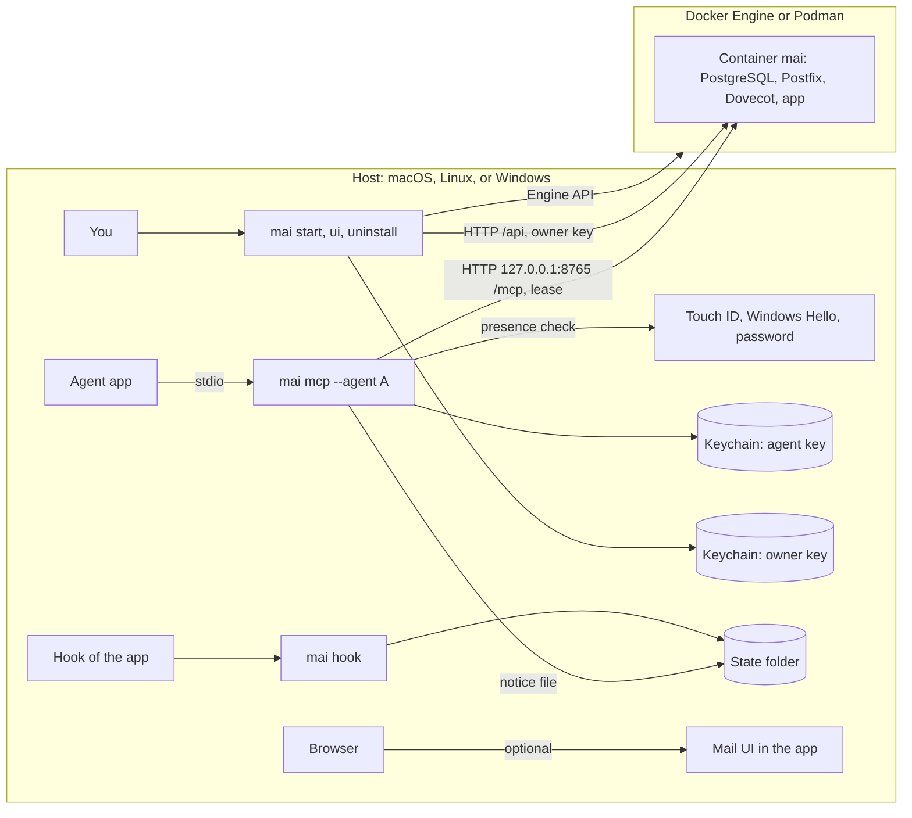

# mai 3.0: one host CLI in Go

Status: design, 12 November 2026. Nothing is built.

Decisions of the user, 12 November 2026:

- The shape is a Go CLI on the host that runs the Docker image of mai.
- Go is an exception to the earlier rule of the project (Python with uv, or
  TypeScript with Yarn Berry). The exception is for the host CLI only. The
  server in the image stays Python.
- 3.0 has no compatibility with 2.x. There is no migration of data,
  credentials, shims, or MCP entries.
- A session of an agent must not get the credential of a different session.
- A program that is not mai must not get access to a session.
- The owner gets a copy of each mail.
- You use only the `mai` command. You do not run `docker`, `podman`, or
  compose.
- `mai uninstall` removes all items that mai made.
- A mail UI is optional. You turn it on and off.

A mark [A] shows an assumption that has no test at this time. A mark [E] shows
an estimate.

## 1. Result first

- **One binary, `mai`, for each OS and architecture.** You install it with
  Homebrew, Scoop, winget, or a download. You use no other command.
- **The CLI operates the container engine.** It finds Docker Desktop, Docker
  Engine, or Podman, starts the engine if it is stopped, pulls the image, and
  makes the container. It uses the Engine API, not the `docker` command.
- **No session secret is on the host.** Session credentials stay in the
  container. An app gets a session through a lease. A lease is a random token
  in the memory of one bridge process. It is not in a file or in the
  keychain.
- **You approve each new lease.** When an app starts the bridge `mai mcp`,
  the OS shows a prompt for Touch ID, Windows Hello, or your password. A
  program that starts `mai mcp` by itself makes the same prompt, and you can
  refuse it.
- **Two limits stay, and section 7 gives them.** A program of your OS user
  that can use the Docker socket controls the container. On Linux, the
  keychain gives no wall between programs of one user.
- **The owner gets a copy of each mail.** Postfix sends a copy of each mail to
  the system mailbox `copies`. Only the owner can read it.
- **The mail UI is optional.** `mai ui on` turns it on, `mai ui open` signs
  you in, and `mai ui off` turns it off. It is off by default.
- **`mai uninstall` removes all that mai made.** A manifest records each
  item. The command removes each item, then does a check that each one is
  gone.
- **Estimate:** 30 to 42 days [E] for phases 1 to 6.
- **Signatures:** deferred. 3.0.0 has an ad-hoc signature on macOS (decision 1).

## 2. Evidence

The prototypes ran on macOS 26 (arm64) with Docker Desktop on 12 November
2026. The Go program is approximately 300 lines. It uses
`github.com/moby/moby/client` v0.6.2 (API 1.56),
`github.com/zalando/go-keyring` v0.2.8, and `golang.org/x/sys` v0.33.0. The
mail tests used a test container from the image `mai:dev`.

### Build

| Result | Value |
|---|---|
| Size of the stripped binary (`-s -w`) | 7.7 MB |
| Cross-build with `CGO_ENABLED=0` | Linux amd64 and arm64, Windows amd64, macOS amd64: each succeeded |

### P1: start time of a hook

Each candidate ran 30 times with a hook payload on stdin. The table gives the
median.

| Candidate | Median | p90 |
|---|---|---|
| Go binary | 4.8 ms | 5.2 ms |
| Python on the host: import of the mai CLI | 35.5 ms | 36.8 ms |
| Python on the host: `mai --help` | 37.1 ms | 38.1 ms |
| The shim of 2.x: `sh` + `docker exec` | 84.7 ms | 93.8 ms |

A hook runs at each prompt of an agent. In 3.0, a hook reads one small local
file and does not call the server (section 6).

### P2: the container lifecycle through the Engine API

The prototype made a container from `mai:dev` with the security values of
2.x:

- A read-only root
- All capabilities dropped, and six added
- Four tmpfs folders
- The two volumes
- A port on `127.0.0.1`

| Step | Time |
|---|---|
| Ping | 6 ms |
| Create | 44 ms |
| Start | 110 ms |
| Until `mai health` passes (through an exec) | 2.6 s |
| Pause (the state shows paused) | 18 ms |
| Unpause | 5 ms |
| Stop, timeout 60 s | 28.7 s, exit code 0 |

**Finding:** the stop is slow. A second stop took 7.5 s: the app took 1.1 s,
Dovecot 6.0 s, and PostgreSQL 0.05 s. The stop right after a start took
28.7 s. Phase 1 must find the cause and set a goal (section 16).

### P3: the system keychain

| Result | Value |
|---|---|
| Set, then get, then delete of a credential | equal text, removed after the delete |
| Time of a set | 28 ms |
| Time of a get | 19 ms |

**Finding:** `go-keyring` on macOS runs `/usr/bin/security -i` and writes the
secret on stdin. The item belongs to the tool `security` of Apple. Thus each
program of the same user can read the item with `security`, and macOS shows
no prompt. Because of this finding, 3.0 keeps no session secret in the
keychain. The CLI reads its two keys through the Security framework, with an
access list that holds only the signed `mai` binary (section 7).

### P4: MCP from stdio to HTTP

A bridge of approximately 30 lines read JSON-RPC lines on stdin and sent each
one to `POST /mcp` of a test container. These calls succeeded:

1. `initialize`: contract 2.1.0, with the capability `resources`.
2. `resources/read` of `mai://guide`: 5229 characters.
3. `login` with a session credential: a `ses-` handle.
4. `whoami` with that handle: `logged_in` true.

### P5: the process chain of the caller

The prototype reads the chain of parent processes with `sysctl`
(`kern.proc.pid` and `kern.procargs2`), with no cgo. It ran in three ways:

| Start of the prototype | Chain, from the process to launchd | Time of the walk |
|---|---|---|
| A command in the terminal tool of Claude Code | `maiproto`, `zsh`, `claude`, `disclaimer`, `Claude` | 0.12 ms |
| The same command after `exec` | `maiproto`, `claude`, `disclaimer`, `Claude` | 0.11 ms |
| A direct child of a host process, as an MCP host starts a server | `maiproto`, host, `zsh`, `claude`, `disclaimer`, `Claude` | 0.19 ms |

**Finding:** after `exec`, a command of a terminal tool is a direct child of
the app. That is the same chain as an MCP server that the app starts. Also,
`sh -c` replaces itself with its last command. Thus a check of the process
chain cannot tell a plain agent from a bridge that the app started. 3.0 uses
the chain only as information in the approval prompt, not as a control.

### P6: a copy of each mail to the owner

The test container ran these changes:

1. A system principal `copies`, with its own mailbox.
2. `always_bcc = copies@mai.internal` in Postfix.
3. The ACL of `copies/INBOX`: `lookup read write write-seen write-deleted
   expunge` for `owner`, and nothing for other logins.

A mail from `alpha` to `beta` went to the INBOX of `beta` and to the INBOX of
`copies`. The IMAP test gave these results:

| Login | `LIST "" "shared/*"` | `SELECT shared/copies/INBOX` |
|---|---|---|
| `owner` | `shared/copies` | `OK`, 1 mail |
| `beta.s1` (a session of `beta`) | `shared/beta` | `NO [NONEXISTENT]` |

Two other methods failed:

- **A detail address of the owner** (`owner+Copies@mai.internal`, with
  `lmtp_save_to_detail_mailbox = yes`). The copy went to the folder
  `Copies`. But this value is global: a mail to `beta+Done@mai.internal`
  went into the folder `Done` of `beta`. That is not safe.
- **The same value for the owner only, as a field of the user lookup.**
  `doveadm user owner` showed the value `yes`, but LMTP did not use it. The
  copy went to the INBOX of the owner.

**Finding:** the copy holds the headers of the mail only. It does not show
the envelope recipients, thus a Bcc recipient is not in the copy. Section 8
adds a record of the envelope.

### P7: what 2.x leaves on a host

An examination of the 2.x install on the test Mac found these items:

- An anonymous volume at `/var/lib/postgresql`. The base image
  `postgres:18.6-alpine` declares `VOLUME /var/lib/postgresql`, thus each new
  container makes a volume that mai does not use. mai keeps its database in
  `/data/pg`.
- A used volume `mai_mai-volume` from an earlier compose file.
- A `docker pull` of the public image failed with `denied` (2.0.1). The cause
  was a ghcr.io credential that the `docker` CLI kept in the macOS keychain.
  The Engine API pulls with no credential, unless the caller gives one.

3.0 mounts a tmpfs at `/var/lib/postgresql`, removes the container with its
anonymous volumes, and pulls the public image with no credential.

## 3. Architecture

The diagram shows the parts on the host and in the engine. Only one port goes
to the host: `127.0.0.1:8765`. IMAP and submission stay in the container.

## 4. Commands

### Lifecycle

| Command | Action |
|---|---|
| `mai start` | Find the engine and start it if it is stopped. If no container exists, pull the image of the CLI version and make the container. Start it and wait until it is healthy. |
| `mai stop` | Stop the container. The volumes stay. |
| `mai pause` / `mai resume` | Freeze and resume the container. An agent in `wait_for_mail` waits until the resume. |
| `mai status` | The health line, the versions of the CLI and of the image, the engine, the data location, the port, and the state of the UI |
| `mai logs [--follow]` | The log of the container |
| `mai doctor` | Examine the engine, the port, the free disk space, the keychain, and the presence check. Give one step for each problem. |
| `mai upgrade` | Pull the image of the new CLI version, then stop, make the container again, start, and wait for health |
| `mai uninstall` | Remove all items of the manifest (section 10) |

`mai start --data-dir PATH` keeps `/data` in a host folder. The CLI writes
the choice to its configuration file (section 11).

### Apps

| Command | Action |
|---|---|
| `mai connect APP --agent A` | Write the MCP entry and the hooks for the app. Show the change, and write it only after you agree. Record the change in the manifest. |
| `mai disconnect APP` | Remove the entries that `mai connect` wrote |

`APP` is one of `claude`, `cursor`, `copilot`, `codex`, and `antigravity`. The
MCP entry is `mai mcp --agent A`. It holds no secret.

### Agents and the owner

| Command | Action |
|---|---|
| `mai agent add NAME ...`, `mai agent list`, `mai agent remove NAME` | Manage agent accounts through the owner API |
| `mai session list` | The sessions, their leases, and the app and folder of each lease |
| `mai session end LOGIN` | End the lease of a session. The bridge gets an error at its next call. |
| `mai approvals` | The approved and refused leases of the last 30 days |

There is no command that shows a session secret.

### Agents

| Command | Action |
|---|---|
| `mai mcp --agent A` | The bridge. An app starts it. It gets a lease and bridges stdio to `/mcp`. |
| `mai hook --format F --event E` | The hook output of the app. It reads the notice file of its bridge. |

### The mail UI

| Command | Action |
|---|---|
| `mai ui on` / `mai ui off` | Turn the UI on or off. The choice stays after a restart. |
| `mai ui open` | Do a presence check, then open the UI in the browser and sign you in |

### Server tasks

| Command | Action |
|---|---|
| `mai backup`, `mai restore STAMP` | Through the owner API. A restore keeps the hold protocol of 2.1. |
| `mai exec -- ARGS` | Run the server CLI in the container, for recovery. It starts after a presence check. |

## 5. The engine and the container

### Only the mai command

You do not run `docker`, `podman`, or compose. The CLI does these steps:

1. Find the engine socket. Examine these locations in sequence [A]:
   - `DOCKER_HOST`
   - The current context of the Docker configuration
   - The default socket of Docker Desktop
   - The default socket of Podman
2. If the socket gives no response, start the engine. On macOS and Windows,
   the CLI starts the Docker Desktop app. For Podman, it starts the Podman
   machine [A].
3. If no engine is installed, stop with the one install step for the OS.
   3.0.0 does not install an engine (decision 5).
4. Pull `ghcr.io/monorithm/mai:<version of the CLI>` with no registry
   credential (P7). Show the progress.
5. Make the container, start it, and wait until `mai health` passes.

### The container definition

The CLI labels each object with `dev.mai.managed-by=mai-cli`.

| Item | Value |
|---|---|
| Image | `ghcr.io/monorithm/mai:<version of the CLI>` |
| Container | `mai` |
| Volumes | `mai3-data` at `/data` (or the host folder), `mai3-spool` at `/var/lib/mai/spool` |
| tmpfs | `/run`, `/tmp`, `/etc/postfix`, `/etc/dovecot`, and `/var/lib/postgresql` (P7) |
| Port | `127.0.0.1:8765` (HTTP) only |
| Security | read-only root, `cap_drop: ALL` and the six capabilities of 2.x |
| Restart policy | `unless-stopped` |
| Stop timeout | 60 s |
| Network | the default bridge network. The CLI makes no network. |

The names `mai3-data` and `mai3-spool` are different from the 2.x names
`mai_mai-data` and `mai_mai-spool`. Thus 3.0 never writes to 2.x data.

If a container `mai` exists with no label of the CLI, `mai start` stops and
shows its name. `mai uninstall --legacy` removes a 2.x install (section 10).

## 6. Sessions and leases

This section tells how mai prevents access by `cursor.s1` to the credential
of `cursor.s2`.

### No session secret on the host

- The server makes and keeps all session credentials. They stay in the
  container. There is no `mai session new`, no `session show`, and no
  credential file.
- An app gets a session only through a lease. The bridge `mai mcp --agent
  cursor` sends a lease request to the server. The server gives a free
  session of the agent, for example `cursor.s2`. If the agent has no free
  session, the server makes one, up to a limit of the owner (default 8).
- The bridge cannot select a session. The lease API has no session argument.
  Thus `cursor.s1` cannot select `cursor.s2`.

### The lease

| Property | Value |
|---|---|
| Token | 256 random bits, in the memory of the bridge only |
| Holder | one bridge process. The server records its app, folder, and process ID. |
| Life | until the bridge stops. The bridge sends a heartbeat each 30 s, and the lease ends 90 s after the last heartbeat. |
| Binding | the token is valid only on the HTTP connection that got it [A] |
| End | `mai session end`, the stop of the bridge, or a restart of the container |

The MCP tools act only as the session of the lease. The tool `login` and the
argument `session` go away (contract 3.0.0).

### The memory of a bridge

The lease token is only in the memory of the bridge. Each OS gives a
different protection of that memory from other programs of the same user:

| OS | Protection | Limit |
|---|---|---|
| macOS | The binary is signed with the hardened runtime and without `get-task-allow`. Thus a program that is not root cannot attach to the bridge [A]. | root can attach |
| Linux | The bridge sets `PR_SET_DUMPABLE` to 0. Thus a program of the same user cannot use `ptrace` or read `/proc/PID/mem`. | root can attach |
| Windows | The bridge sets an access list on its process that refuses `PROCESS_VM_READ` [A]. | The user owns the process and can change the access list. The binding to the connection is the remaining control. |

### What a session is for each app

A session belongs to one bridge process. Each app has its own rule for the
start of a bridge. An MCP server gets no ID of a chat, thus two chats that
share one bridge share one session.

| App | One bridge for each |
|---|---|
| Claude Code | `claude` process |
| Cursor | window [A] |
| VS Code with Copilot | window [A] |
| Codex, Antigravity | process of the app [A] |

### Hooks

The bridge writes a notice file in the state folder, with mode 0600. The file
holds the session name and the count of new mail. It holds no secret and no
mail text. `mai hook` finds the file of its bridge through the process chain
of the app (P5). The hook never calls the server, and it never fails: on an
error it prints nothing and exits 0.

## 7. Protection from programs that are not mai

This section tells how mai prevents access to a session by a plain agent. A
plain agent is an agent with no mai MCP entry.

### Two keys on the host

| Key | Use | Where |
|---|---|---|
| Owner key | The owner API `/api` | Keychain, service `dev.mai`, account `owner` |
| Agent key, one for each agent | The lease API | Keychain, service `dev.mai`, account `agent:<name>` |

On macOS, the CLI writes and reads each key through the Security framework.
The access list of each item holds only the signed `mai` binary, by its
designated requirement. A different program that reads the item, also
`security`, makes macOS show a prompt [A]. P3 shows why the CLI must not use
`/usr/bin/security` for this.

The server keeps only a hash of each key. In 2.x, the file
`/data/secrets/owner.cred` held the owner credential in clear text. 3.0 has
no such file. At the first start, the CLI makes the owner key on the host and
gives only its hash to the container.

### The approval of a lease

Before the bridge reads the agent key for a new lease, it does a presence
check:

| OS | Presence check |
|---|---|
| macOS | LocalAuthentication: Touch ID, or the password of the user |
| Windows | Windows Hello. The agent key is a key of Windows Hello in the TPM, thus each signature occurs only after the gesture [A]. |
| Linux | polkit, with an action that the package installs [A] |

The prompt shows the agent, the app at the top of the process chain, the
folder of the bridge, and its process ID. P5 shows that the chain is
information, not proof.

You can set the approval rule with `mai config set approval RULE`:

| Rule | Effect |
|---|---|
| `each-bridge` (default) | A presence check for each new bridge |
| `app-instance` | One check for each start of an app. A plain agent in the same app instance can then get a lease. |

### The paths of a plain agent

| Path of a plain agent | Control | Limit |
|---|---|---|
| Read a session secret | No session secret exists on the host | none |
| Read a key from the keychain | The access list holds only the signed `mai` | On Linux, the Secret Service gives each program of the user access [A] |
| Start `mai mcp` itself, also with `exec` | The presence check. You see an unexpected prompt and refuse it. | A prompt at the same time as a correct prompt can trick you |
| Call `/mcp` or `/api` directly | The server refuses a call with no lease token and no owner key | none |
| Use IMAP or SMTP | The container publishes no mail ports | none |
| Read the memory of a bridge | The table "The memory of a bridge" | Windows, and root on each OS |
| Change the `mai` binary | A changed binary has a different signature. The keychain refuses it. | Linux and Windows have no such check |
| Use the Docker socket, for example `docker exec mai` | none | **A program with access to the socket is root in the container and can read all mail.** |

### The hard limit

A program of your OS user runs with your rights. For a wall that has no
limit, run the agent in a sandbox or as a different OS user:

- The sandbox of the agent app must refuse the Docker socket and the
  keychain to the commands of the agent [A].
- In some apps, the sandbox covers the terminal tool but not the MCP
  servers. Then the bridge runs and the plain commands of the agent do not
  [A].
- The docs give a sandbox profile for each app in phase 4.

## 8. A copy of each mail to the owner

### The design

- `mai init` makes the system principal `copies`. It has no session and no
  password. Its mailbox holds the copies.
- Postfix has `always_bcc = copies@mai.internal`. Postfix adds the copy
  recipient one time for each new mail, also when the owner is a recipient.
  Postfix does not add it to a bounce that it makes.
- The ACL of `copies/INBOX` gives the owner `lookup read write write-seen
  write-deleted expunge`. Agents and sessions get no right.
- The milter refuses a recipient `copies@mai.internal` from a session. Thus
  an agent cannot put mail into the copies.
- The milter writes the envelope of each mail to the database: the sender,
  each recipient (also Bcc), the queue ID, and the Message-ID. The UI shows
  the envelope to the owner only.
- All mail goes through Postfix: the MCP tools send through submission in the
  container. A move of a mail between folders is not a new mail and makes no
  copy.

P6 gives the test of this design and of the two methods that failed.

### Size

The copies approximately double the space for mail on the disk [E]. The
owner can delete copies in the UI. A backup holds the copies.

## 9. The mail UI (optional)

### On and off

- `mai ui on` and `mai ui off` set the state in the database. The default is
  off.
- When the UI is off, each route of `/ui` gives 404, and the server makes no
  sign-in ticket.
- The UI uses the port `127.0.0.1:8765` of the API. There is no new port.

### Sign-in

1. `mai ui open` does a presence check.
2. The CLI gets a sign-in ticket from `/api` with the owner key. The ticket is
   valid one time, for 60 s.
3. The CLI opens `http://127.0.0.1:8765/ui/sign-in#t=<ticket>` in the
   default browser. The ticket is in the fragment, thus the browser does not
   send it in the URL.
4. The page sends the ticket in a POST and gets a cookie with `HttpOnly`,
   `SameSite=Strict`, and a life of 12 h (idle limit 30 min).

### Content of 3.0.0

| View | Content |
|---|---|
| All mail | The `copies` mailbox, with the envelope of each mail and a search |
| Threads | Each thread with its mails, its claim, and its state |
| Agents | The queue of each agent, read only |
| Inbox | The mail to the owner |
| Board | The board of 2.x |
| Sessions | The sessions and leases, and the command `session end` |

The UI shows no secret. A reply from the UI is decision 6.

## 10. Uninstall

### The manifest

The CLI records each item that it makes, in `manifest.json` in its state
folder. Each record has the type, the name or path, and the ID. A record of
a change in a file of an app also has a hash of the content. The manifest
holds no secret.

### What `mai uninstall` removes

1. All leases. The bridges stop at their next call.
2. The container `mai`, with its anonymous volumes.
3. The volumes `mai3-data` and `mai3-spool`, or the content of the host data
   folder that mai made.
4. Each image that the CLI pulled, by its image ID. The CLI does not remove an
   image that a different container uses.
5. The entries that `mai connect` wrote in the files of the apps. If you
   changed an entry, the CLI shows the difference and waits for your decision.
6. The keychain items of the service `dev.mai`.
7. The configuration folder, the state folder (manifest, notice files,
   approvals), and the cache and log folder of the CLI.
8. The polkit action on Linux, and the shell completion files, if the
   package installed them.
9. The binary. If a package manager installed it, the CLI runs the
   uninstall of that package manager as the last step. On Windows, a
   direct download removes itself after the exit of the process [A].

The CLI does not remove the engine, because mai did not install it.

### Confirmation and check

- The CLI shows the list of items and the size of the mail data. You type
  `uninstall` to agree. In a script, use `--yes`.
- `--backup PATH` writes a backup archive to `PATH` before the remove. The
  archive is yours, and the CLI does not record it.
- After the remove, the CLI does a check of each record of the manifest. It
  also searches the engine for objects with the label
  `dev.mai.managed-by=mai-cli`, and the keychain for the service `dev.mai`.
  It reports each item as gone or as a failure, and exits 1 on a failure.
- Caution: `mai uninstall` deletes all mail and all copies, and the CLI keeps
  no copy unless you use `--backup`.

### The removal of a 2.x install

`mai uninstall --legacy` removes these items of 2.x, after you type
`uninstall` to agree:

- The container `mai` of compose, with its anonymous volumes
- The volumes `mai_mai-data`, `mai_mai-spool`, and `mai_mai-volume`
- The images `ghcr.io/monorithm/mai` with a tag 2.x
- The shims and `compose.yaml` that `mai shim install` wrote, and `~/.mai`

It does not read or move 2.x data. It does not change the files of the apps,
because 2.x did not record its changes there. It lists the 2.x MCP entries
that it finds, for you to remove.

## 11. Folders of the CLI

| OS | Configuration | State | Cache and log |
|---|---|---|---|
| macOS | `~/Library/Application Support/mai` | `~/Library/Application Support/mai/state` | `~/Library/Caches/mai` |
| Linux | `$XDG_CONFIG_HOME/mai` | `$XDG_STATE_HOME/mai` | `$XDG_CACHE_HOME/mai` |
| Windows | `%AppData%\mai` | `%LocalAppData%\mai\state` | `%LocalAppData%\mai\cache` |

On Linux, each XDG variable has the default of the XDG specification. The
configuration file holds the data folder, the port, the approval rule, and an
image tag if you pin one. No folder holds a secret.

## 12. Changes on the server

| Change | Cause |
|---|---|
| MCP contract 3.0.0: no tool `login`, no argument `session` | The lease gives the session (section 6) |
| The lease API: get, heartbeat, end | Section 6 |
| A complete owner API in `/api`: agents, sessions, leases, backup, restore, UI state, health | The CLI uses HTTP, not `docker exec` |
| Hashes of the owner key and of the agent keys, no `owner.cred` | Section 7 |
| The principal `copies`, `always_bcc`, the ACL, and the envelope record | Section 8 |
| The mail views of the UI and the state on or off | Section 9 |
| No published IMAP or submission ports | Agents use only MCP |
| `GET /api/version` | `mai status` and `mai upgrade` compare versions |
| The stop time of the controller | The goal of section 16 |

## 13. Breaking changes

3.0 has no compatibility with 2.x:

- The shims `bin/mai`, `bin/mai.ps1`, `bin/mai.cmd`, `mai shim install`, and
  `compose.yaml` go away.
- Session credentials, credential files, `--credential-file`, and
  `MAI_CREDENTIAL_FILE` go away. A lease replaces them.
- The MCP tool `login` and the argument `session` go away. The contract is
  3.0.0.
- The host ports 1993 (IMAPS) and 1587 (submission) go away.
- 3.0 uses new volumes. It does not read 2.x data, and there is no import.

## 14. Repository and release

| Part | Location |
|---|---|
| Go module | `cli/` with `go.mod`, `cmd/mai`, and the `internal/` packages `engine`, `keychain`, `presence`, `api`, `bridge`, `hook`, `connect`, `manifest`, and `uninstall` |
| Tests | `go test` on macOS, Linux, and Windows in CI. The tests of the lifecycle use a test container, as `scripts/it_container.sh` does. |
| macOS build | With cgo for the Security framework and LocalAuthentication, thus on a macOS runner |
| Release | GoReleaser on the tag `vX.Y.Z`: six binaries (macOS, Linux, and Windows, each amd64 and arm64), checksums, the Homebrew tap `monorithm/homebrew-tap`, a Scoop bucket, and a winget manifest |
| Image | The image workflow, with the same version as the CLI |

## 15. Security summary

- Session secrets stay in the container. The host has two kinds of keys,
  each in the keychain with an access list for `mai` only (macOS).
- Each new lease starts only after a presence check. A lease is a token in
  memory, bound to one connection.
- The container publishes only `127.0.0.1:8765`, with the Host and Origin
  rules of 2.x.
- The owner gets a copy of each mail. Agents cannot read or add to the
  copies.
- The CLI never puts a secret in an argument, in the environment of a child
  process, or in a file.
- The trust rules of 2.x stay: a notice has only text of the server, and a
  mail never carries user approval.
- The limits are in section 7: the Docker socket, root, Linux keychains, and
  Windows process memory.

## 16. Phases

| Phase | Content | Days [E] |
|---|---|---|
| 1 | The Go module, the engine package, the lifecycle commands, `doctor`, the manifest, `uninstall`, and `uninstall --legacy`. The cause of the slow stop, with a goal of less than 10 s. | 7 to 9 |
| 2 | The server for contract 3.0.0: leases, the owner API, the key hashes, the copies, the envelope record, and no mail ports | 6 to 8 |
| 3 | The keychain package with access lists, the presence check on the three OS, and the first start of the owner | 6 to 9 |
| 4 | The bridge, the notice files and `mai hook`, `connect` and `disconnect`, and a sandbox profile for each app | 4 to 6 |
| 5 | The mail UI and `mai ui` | 4 to 6 |
| 6 | GoReleaser, the packages, the signatures, and a release candidate | 3 to 4 |
| Total | | 30 to 42 |

## 17. Alternatives

| Alternative | Result | Cause |
|---|---|---|
| A Python CLI with `uv tool install` | Not chosen | It starts in 37 ms (P1). It must have Python and uv on each host, and it is not one file. |
| Session secrets in the keychain, as in the first draft | Not chosen | P3: each program of the user can read them on macOS. |
| A check of the process chain as the control | Not chosen | P5: `exec` gives a plain agent the same chain as a bridge. |
| A key in the Secure Enclave of macOS | Not chosen for 3.0.0 | It is possible only in an app bundle with a provisioning profile. The access list of the keychain gives most of the protection. |
| A detail address of the owner for the copies | Not chosen | P6: the global LMTP value lets mail into each folder of an agent. |
| Agents as a different OS user | Not the default | It gives the hard wall, but each app must run as that user. The docs give it as an alternative. |
| One Go binary with no Docker | Not chosen for 3.0 | It must have a new mail server and storage in place of Postfix, Dovecot, and PostgreSQL. |

## 18. Decisions for the user

1. **Signatures.** Deferred by the user on 12 November 2026. 3.0.0 has an
   ad-hoc signature on macOS. The access list of the keychain then holds the
   hash of the code of one build. Thus macOS shows one keychain prompt after
   each upgrade. An Apple Developer ID (a paid membership) removes that
   prompt.
2. **The approval rule.** Recommendation: `each-bridge` as the default.
3. **Linux.** The Secret Service gives no wall between programs of one user.
   Recommendation: polkit for the presence check, and a warning in `mai
   doctor` that names the sandbox profile.
4. **The limit of sessions for each agent.** Recommendation: 8.
5. **The engine install.** Recommendation: 3.0.0 does not install an engine.
   It gives the install step for the OS. A subsequent version can install Podman
   through the package manager after you agree.
6. **A reply from the UI.** Recommendation: read only in 3.0.0, and replies in
   3.1.
7. **Install channels for 3.0.0.** Decided by the user on 12 November 2026:
   3.0.0 is a Go module only, and you install it with `go install`. Binaries
   and packages come in a subsequent release.

## 19. Assumptions to prove

- [A] Podman gives the same Engine API calls for the lifecycle steps, and the
  CLI can start a stopped Podman machine.
- [A] A keychain item with an access list for `mai` only makes macOS show a
  prompt when `security` reads it.
- [A] A signed bridge with the hardened runtime refuses an attach from a
  program that is not root.
- [A] Windows Hello can sign with a TPM key for a desktop program with no
  package identity.
- [A] Windows lets a process refuse `PROCESS_VM_READ` to other programs of
  the user.
- [A] Through the port forward of Docker Desktop, one host connection stays
  one connection in the container, thus the server can bind a lease to it.
- [A] Cursor, VS Code, Codex, and Antigravity start one bridge for each
  window or process, as section 6 gives.
- [A] The sandbox of each app can refuse the Docker socket and the keychain
  to the commands of the agent.
- [A] `mai pause` with an agent in `wait_for_mail` gives a timeout and not an
  error to the agent after the resume.
