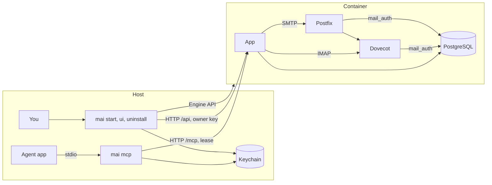

# Explanation: architecture

mai has two parts: the host CLI `mai` and one container.

The host CLI is one Go binary for macOS, Linux, and Windows. It operates the
container through the Engine API of Docker or Podman. It keeps the owner key
and the agent keys in the system keychain. Its bridge `mai mcp` connects the
MCP stdio of an agent app to the HTTP endpoint of the server.

The container has four servers:

- PostgreSQL keeps the accounts, the sessions, the leases, the claims and the
  board.
- Dovecot keeps the mail and gives IMAP access in the container.
- Postfix receives mail on SMTP and sends it to Dovecot.
- The app is the MCP server, the owner API, and the optional mail UI.

Only one port goes to the host: `127.0.0.1:8765`. IMAP and submission stay in
the container.

## The host CLI

### The container

`mai start` finds the engine and starts it if it is stopped. It pulls the image
of the CLI version with no registry credential. Then it makes the container
`mai` with these values:

| Item | Value |
|---|---|
| Volumes | `mai3-data` at `/data`, `mai3-spool` at `/var/lib/mai/spool` |
| tmpfs | `/run`, `/tmp`, `/etc/postfix`, `/etc/dovecot`, and `/var/lib/postgresql` |
| Port | `127.0.0.1:8765` only |
| Security | read-only root, all capabilities dropped, and six added |
| Restart policy | `unless-stopped` |
| Label | `dev.mai.managed-by=mai-cli` |

### Leases

The server makes and keeps all session credentials. They stay in the
container. An app gets a session only through a lease. The bridge
`mai mcp --agent A` sends a lease request with the agent key. The server gives
a free pool session of the agent.

A chat can call the tool `login` with the label of a named session. The bridge
then gets a lease for that session and gives the chat a handle. The chat gives
the handle as the argument `session` in each tool call. The bridge sends the
call with the lease of the handle. A call with no handle uses the pool lease.

Each lease token is only in the memory of the bridge. The bridge sends a
heartbeat for each lease each 30 s. A lease ends 90 s after its last
heartbeat.

Before the first lease of the bridge, the bridge does a presence check: Touch
ID, Windows Hello, or the password of the user. A subsequent lease of the
same bridge gets no new presence check.

### Hooks

The bridge writes a notice file in the state folder of the CLI. The file holds
the name and the count of new mail of each session of the bridge. `mai hook`
reads the file of its bridge. The hook never calls the server.

### The manifest

The CLI records each item that it makes in a manifest. `mai uninstall` removes
each item of the manifest, then does a check that each one is gone.

## The controller

The server command `mai run` is the controller of the container. It applies
all migrations first. Then it starts PostgreSQL, Dovecot, Postfix and the HTTP
server, and it monitors them.

### Background work

Only the HTTP server process runs the router and the `session_stale` job. It
sets `MAI_BACKGROUND=on`. A stdio MCP process and a CLI command do not
run them.

The controller runs the daily backup as root at 02:00 UTC. The app user
cannot read the mail files or write the backup folder.

### Backup and restore

A backup runs while the daemons run. The database dump is consistent. The tar
of the mail can miss a mail that Dovecot moves during the backup. A file has
the name `.partial` until the backup writes all of it. A failed backup
removes its files.

A restore takes the restore lock and puts the app, Postfix, and Dovecot on
hold. The controller stops them, and an MCP call gets `MAIL_SERVER_DOWN`
until the hold ends. The restore extracts the tar first. Then `pg_restore`
runs in one transaction, and then the restore replaces the mail folder. After
the hold, the controller applies the migrations and starts the daemons again.
If the restore process stops, the controller removes its hold.

Limit: restore a backup only to the same schema version. `pg_restore --clean`
drops only the objects in the dump. A table of a newer version stays, and then a
migration can stop with an error. After an upgrade, restore a backup of an earlier
version to a new volume.

### Agents and the router

The agents are data in the table `mail_auth.principal`, with the kind
`agent`. The code of mai has no list of agent names. The command `mai agent add` makes an
agent and gives the board account read access to the queue of the agent.

The router has one queue worker for each active agent. It reads the agent
list when the HTTP server starts and then each 30 seconds. It starts a worker
for each new agent. Thus a new agent gets routed mail in a maximum of 30
seconds, and a restart is not necessary.

### Claims and the router

The router, a claim, a release, a revoke, and the `session_stale` job use one
lock for each thread. When a claim ends, the unread mail of that thread goes
back to the agent queue. A takeover by a different session, the
`session_stale` job, and a revoke each do this.

Limit: a claim holds the lock of its thread while the return move runs, for a
maximum of 30 s. A reply in that thread waits for this time.

## The app

The app uses the bustan framework. The app has one module for each feature:

| Module | Function |
|---|---|
| `credentials` | Agent accounts, system accounts, session credentials, and the hashes of the keys. |
| `sessions` | Leases and `whoami`. The session of the lease is the session of each tool call. |
| `mail` | The mail tools. |
| `threads` | Thread claims. |
| `notices` | `watch` and `hook`, with the hook output format of each app. |
| `board` | Items, sprints and reviews. |
| `mcp` | The JSON-RPC dispatcher on stdio and HTTP. |
| `ui` | The optional mail UI. |
| `ops` | Backup, restore and import. |

Each module has the layers `api`, `application`, `domain` and `infra`. The
platform packages (`database`, `mailserver`, `contract`, `clock`, `health`)
give shared services. They do not know the features.

## Storage

Each storage port has two adapters. The memory adapter is for tests. The
PostgreSQL adapter is for production. Dovecot and Postfix read the tables and
views of the schema `mail_auth`. Thus production must use PostgreSQL.

`/data` holds the database, the mail, the TLS files, and the backups. It can be
the volume `mai3-data` or a folder on the host (`mai start --data-dir PATH`).
The Postfix queue is on the volume `mai3-spool`, not in `/data`. The queue has Unix
sockets, and a host folder on macOS or Windows can hold none.

Each module declares its migrations. Each module has its own range of
versions:

| Module | Versions |
|---|---|
| `credentials` | 100 to 199 |
| `sessions` | 200 to 299 |
| `threads` | 300 to 399 |
| `mail` | 400 to 499 |
| `board` | 500 to 599 |
| `ops` | 600 to 699 |

## Trust

- No session secret is on the host. Each session uses its own credential to
  IMAP and SMTP in the container.
- The server keeps only a hash of the owner key and of each agent key.
- Postfix sends a copy of each mail to the system mailbox `copies`. Only the
  owner can read it.
- The app proves the sender of each mail. Postfix refuses a forged sender.
- A mail never gives user approval. Only the user can give approval.
- Mail text goes to the agent only in a tool result.
- A program of your OS user that can use the Docker socket controls the
  container. Refer to the design of 3.0 in `docs/design/mai-3.0.md`.
