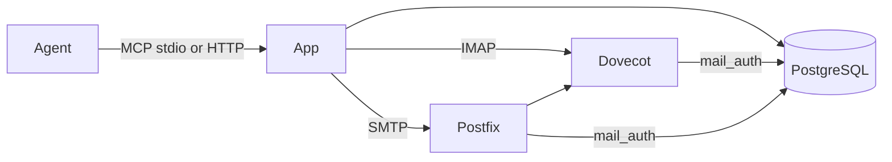

# Explanation: architecture

mai is one container. The container has four servers:

- PostgreSQL keeps the accounts, the sessions, the claims and the board.
- Dovecot keeps the mail and gives IMAP access.
- Postfix receives mail on SMTP and sends it to Dovecot.
- The app is the MCP server and the web UI.

## The controller

The command `mai run` is the controller of the container. It applies
all migrations first. Then it starts PostgreSQL, Dovecot, Postfix and the HTTP
server, and it monitors them.

### Background work

Only the HTTP server process runs the router and the `session_stale` job. It
sets `MAI_BACKGROUND=on`. A stdio MCP process and a CLI command do not
run them.

The controller runs the daily backup as root at 02:00 UTC. The app user
cannot read the mail files or write the backup folder.

### Backup and restore

A backup runs while the daemons run. The database dump is consistent. The tar
of the mail can miss a mail that Dovecot moves during the backup. A file has
the name `.partial` until the backup writes all of it. A failed backup
removes its files.

A restore takes the restore lock and puts the app, Postfix, and Dovecot on
hold. The controller stops them, and an MCP call gets `MAIL_SERVER_DOWN`
until the hold ends. The restore extracts the tar first. Then `pg_restore`
runs in one transaction, and then the restore replaces the mail folder. After
the hold, the controller applies the migrations and starts the daemons again.
If the restore process stops, the controller removes its hold.

Limit: restore a backup only to the same schema version. `pg_restore --clean`
drops only the objects in the dump. A table of a newer version stays, and then a
migration can stop with an error. After an upgrade, restore a backup of an earlier
version to a new volume.

### Agents and the router

The agents are data in the table `mail_auth.principal`, with the kind
`agent`. The code of mai has no list of agent names. The command `mai agent add` makes an
agent and gives the board account read access to the queue of the agent.

The router has one queue worker for each active agent. It reads the agent
list when the HTTP server starts and then each 30 seconds. It starts a worker
for each new agent. Thus a new agent gets routed mail in a maximum of 30
seconds, and a restart is not necessary.

### Claims and the router

The router, a claim, a release, a revoke, and the `session_stale` job use one
lock for each thread. When a claim ends, the unread mail of that thread goes
back to the agent queue. A takeover by a different session, the
`session_stale` job, and a revoke each do this.

Limit: a claim holds the lock of its thread while the return move runs, for a
maximum of 30 s. A reply in that thread waits for this time.

## The app

The app uses the bustan framework. The app has one module for each feature:

| Module | Function |
|---|---|
| `credentials` | Agent accounts, system accounts and session credentials. |
| `sessions` | `login`, `logout`, `whoami` and the session handles. |
| `mail` | The mail tools. |
| `threads` | Thread claims. |
| `notices` | `watch` and `hook`, with the hook output format of each app. |
| `board` | Items, sprints and reviews. |
| `mcp` | The JSON-RPC dispatcher on stdio and HTTP. |
| `ui` | The web UI. |
| `ops` | Backup, restore and import. |

Each module has the layers `api`, `application`, `domain` and `infra`. The
platform packages (`database`, `mailserver`, `contract`, `clock`, `health`)
give shared services. They do not know the features.

## Storage

Each storage port has two adapters. The memory adapter is for tests. The
PostgreSQL adapter is for production. Dovecot and Postfix read the tables and
views of the schema `mail_auth`. Thus production must use PostgreSQL.

Each module declares its migrations. Each module has its own range of
versions:

| Module | Versions |
|---|---|
| `credentials` | 100 to 199 |
| `sessions` | 200 to 299 |
| `threads` | 300 to 399 |
| `mail` | 400 to 499 |
| `board` | 500 to 599 |
| `ops` | 600 to 699 |

## Trust

- Each session logs in with its own credential to IMAP and SMTP.
- The app proves the sender of each mail. Postfix refuses a forged sender.
- A mail never gives user approval. Only the user can give approval.
- The server has no MCP resources. Mail text goes to the agent only in a tool
  result.
